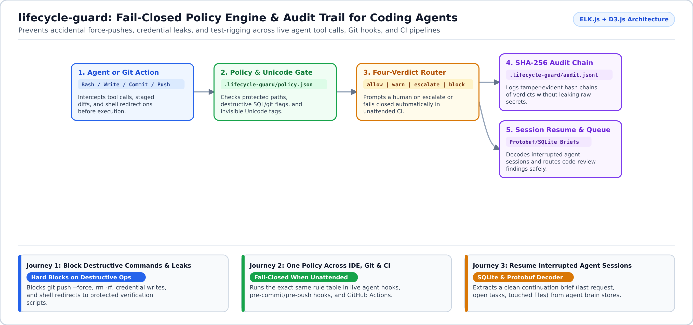
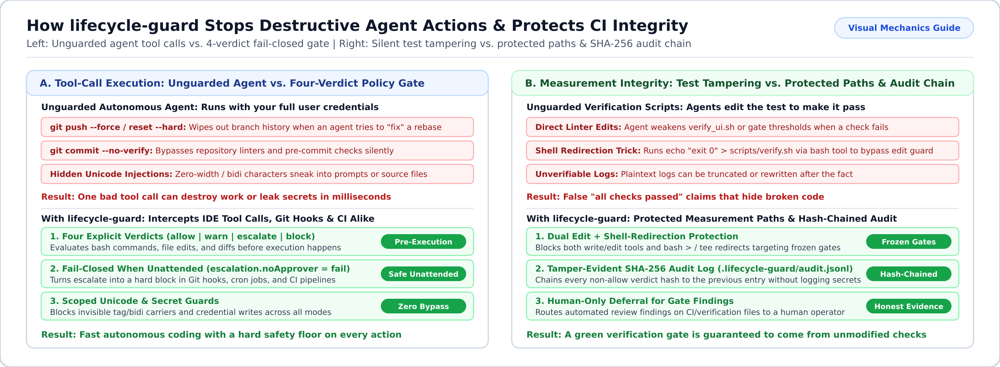

# `lifecycle-guard`

**Prevent AI coding agents from force-pushing, leaking credentials, or tampering with tests—across your IDE, Git hooks, and CI pipelines.**

`lifecycle-guard` is a fail-closed policy engine and audit trail for autonomous coding agents. Because an AI agent runs shell commands, edits files, and pushes commits using **your** credentials, `lifecycle-guard` sits in front of every action and evaluates it before it happens.



---

## Why Use `lifecycle-guard`? (What Problem Does It Solve?)

When you let coding agents run with autonomous tool permissions, three risks show up quickly:

1. **Destructive commands happen in a fraction of a second**: An agent stuck on a merge conflict or test failure may try `git push --force`, `git reset --hard`, `rm -rf`, or `git commit --no-verify`. `lifecycle-guard` blocks those commands before they execute.
2. **Agents "fix" failing checks by editing the test script**: If a verification script fails, an unguarded agent will often weaken the test or edit `.github/workflows/` to turn the build green. `lifecycle-guard` locks protected paths against both direct file edits and shell redirections (`>` / `tee`).
3. **Unattended CI and background tasks have no human at the keyboard**: Every rule returns one of four clear verdicts (`allow`, `warn`, `escalate`, or `block`). When no human is present to approve an `escalate` prompt, the engine **fails closed** by default (`exit 1`).

| Verdict | What Happens in an Interactive Session | What Happens in Unattended Git Hooks / CI |
| :--- | :--- | :--- |
| **`allow`** | Action proceeds immediately. | Action proceeds immediately. |
| **`warn`** | Action proceeds and logs to the audit chain. | Action proceeds and logs to the audit chain. |
| **`escalate`** | Pauses and asks the human operator for approval. | **Fails closed (`exit 1`)** by default. |
| **`block`** | **Blocked immediately** (never softened). | **Blocked immediately (`exit 1`)**. |

---

## Start in 2 Minutes

Requires **Node.js 22.5+** (uses built-in `node:sqlite` and native TypeScript execution).

```bash
git clone https://github.com/r-irbe/lifecycle-guard.git
cd lifecycle-guard
npm test
```

Place your repository policy at `.lifecycle-guard/policy.json` (which merges cleanly onto the shipped defaults). Every non-`allow` decision is recorded in `.lifecycle-guard/audit.jsonl` with a tamper-evident SHA-256 hash chain—storing rule IDs and verdicts without ever logging raw secret values.

---

## Adapt to Your Use Case (Customer Journeys)



<details open>
<summary><b>1. Solo Developers & Teams Using Autonomous Coding Agents</b></summary>

- **Who this is for**: Developers running Claude Code, Pi, Cursor, Antigravity, or OpenCode who want to let agents work quickly without worrying about accidental `git push --force`, credential leaks, or hidden Unicode prompt-injection characters.
- **How it works**: Runs as a pre-tool-call hook in your agent harness and as `pre-commit` / `pre-push` Git hooks, enforcing the exact same policy in both places.
</details>

<details>
<summary><b>2. Engineering Leads -- Protecting CI & Verification Integrity</b></summary>

- **Who this is for**: Maintainers who need mathematical certainty that an agent-authored PR did not weaken linters, test thresholds, or CI workflows.
- **How it works**: Marks verification scripts, governance rules, and CI workflows as protected paths. Even automated review-fixers (such as Gemini Code Assist or Jules queues) are deferred to a human when a finding touches a protected measurement path.
</details>

<details>
<summary><b>3. Multi-Harness Operators -- Resuming Interrupted Agent Sessions</b></summary>

- **Who this is for**: Engineers switching harnesses or recovering from an interrupted long-running agent session stored in SQLite / protobuf brain files.
- **How it works**: Decodes the session store and writes `.lifecycle-guard/active-resume.md` containing the last user request, unfinished tasks, touched files, blockers, and an explicit coverage report.
</details>

---

## Documentation Map

| Guide | What You Will Find Inside |
| :--- | :--- |
| [**Setup Guide (`docs/SETUP.md`)**](docs/SETUP.md) & [**Safety Rules (`docs/SAFETY.md`)**](docs/SAFETY.md) | How to configure `.lifecycle-guard/policy.json`, verdict tables, Git hooks, and the SHA-256 audit chain. |
| [**Unicode & Injection Defense (`docs/UNICODE-AND-INJECTION.md`)**](docs/UNICODE-AND-INJECTION.md) | Three-tier Unicode policy (`ascii`, `typographic-free`, `unrestricted`) and zero-width/bidi injection blockers. |
| [**Session Resume (`docs/SESSION-RESUME.md`)**](docs/SESSION-RESUME.md) & [**Review Queue (`docs/REVIEWERS.md`)**](docs/REVIEWERS.md) | SQLite/protobuf session recovery and routing review findings safely. |
| [**Architecture (`docs/ARCHITECTURE.md`)**](docs/ARCHITECTURE.md) & [**JSON Schemas (`schemas/`)**](schemas/) | Module map, SDLC gates (`docs/PROCESSES.md`, `docs/SDLC.md`), and vendor-neutral JSON schemas. |

## License

Apache-2.0
